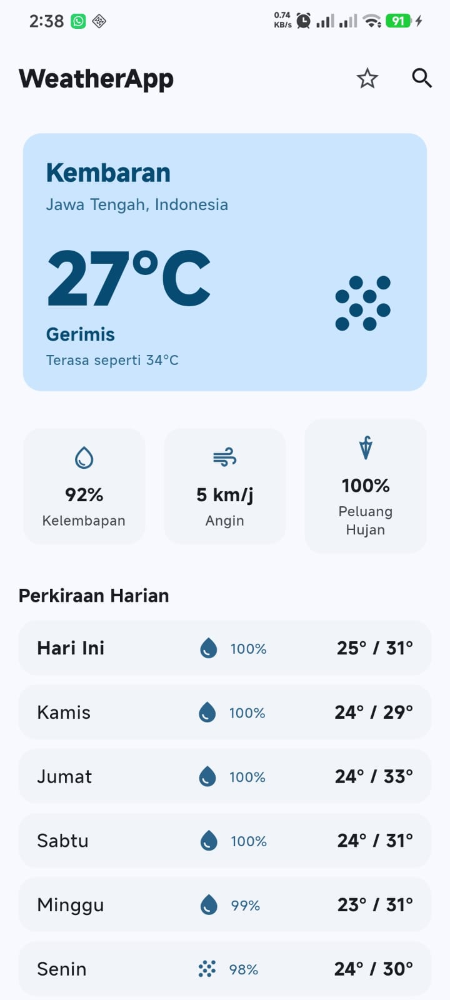
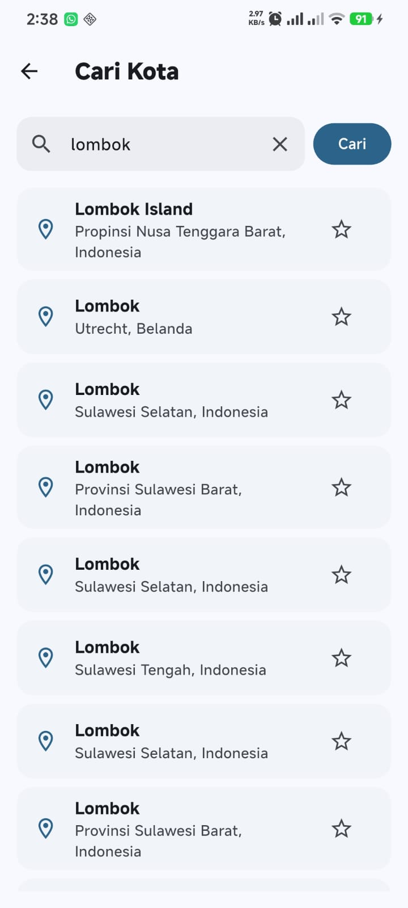

# WeatherApp Flutter (Responsi Pemrograman Mobile)

Aplikasi cuaca berbasis Flutter yang menampilkan kondisi cuaca terkini dan prakiraan 7 hari ke depan menggunakan data real-time dari **Open-Meteo API**, dengan arsitektur **MVVM (Model-View-ViewModel)**, state management **`StatefulWidget` + `setState`**, dan penyimpanan lokal **Hive**.

| Item | Keterangan |
|---|---|
| Nama Mahasiswa | Satria |
| NIM | H1D024022 |
| Framework | Flutter (Dart) |
| Arsitektur | MVVM (Model-View-ViewModel) |
| State Management | `StatefulWidget` + `setState` |
| Penyimpanan Lokal | Hive (`hive` & `hive_flutter`) |
| Sumber Data | Open-Meteo Weather Forecast API & Geocoding API |ketik

---

## Fitur Utama

1. **Home / Weather Screen**
   - Menampilkan nama kota, wilayah/negara, kondisi cuaca terkini (`weather_code` yang dipetakan ke ikon Material dan deskripsi Bahasa Indonesia), suhu saat ini (°C), dan suhu terasa.
   - Menampilkan metrik detail: kelembapan (`%`), kecepatan angin (`km/j`), dan peluang hujan maksimum hari ini (`%`).
   - Menampilkan prakiraan cuaca harian (7 hari ke depan) beserta suhu minimum dan maksimum.
   - Daftar **Kota Favorit** cepat untuk berpindah kota dengan sekali tap.
   - Penanganan state **Loading** (`CircularProgressIndicator`), **Data Kosong** (ajakan mencari kota), dan **Error** (pesan jelas + tombol **Coba lagi**).

2. **Search / Location Screen**
   - Pencarian kota secara langsung ke Open-Meteo Geocoding API (minimal 2 karakter).
   - Menampilkan nama kota, wilayah (`admin1`), dan negara (`country`).
   - Tombol bintang untuk menyimpan/menghapus kota dari favorit.
   - Riwayat pencarian (maksimal 10 kata kunci terbaru) yang tersimpan di Hive dan tampil saat input kosong.
   - Penanganan kondisi `"Kota tidak ditemukan"` ketika API tidak mengembalikan field `results`.

3. **Persistensi Data Lokal (Hive)**
   - Data kota favorit, riwayat pencarian, dan kota aktif terakhir tetap tersimpan setelah aplikasi ditutup dan dimuat ulang saat aplikasi dibuka kembali.

---

## Struktur Proyek & Arsitektur MVVM

```text
lib/
├── main.dart                          # Inisialisasi Hive, MaterialApp, Theme, dan Routes
├── config/
│   ├── app_theme.dart                 # ThemeData Material 3 terpusat (warna & textTheme)
│   └── api_config.dart                # Base URL dan pembangun URI Open-Meteo
├── models/
│   ├── weather_model.dart             # Model respons forecast (CurrentWeather & DailyForecast)
│   ├── location_model.dart            # Model hasil geocoding (name, lat, lon, country, admin1)
│   └── favorite_model.dart            # Model favorit dengan konversi Map untuk Hive
├── services/
│   ├── api_exception.dart             # Exception kustom (noInternet, timeout, server, parse)
│   ├── weather_service.dart           # HTTP GET ke Weather Forecast API
│   └── geocoding_service.dart         # HTTP GET ke Geocoding API
├── repositories/
│   └── local_storage_repository.dart  # CRUD Hive: favorites, search_history, settings
├── viewmodels/
│   ├── home_viewmodel.dart            # State & logika HomeScreen (tanpa import widget)
│   └── search_viewmodel.dart          # State & logika SearchScreen (tanpa import widget)
├── views/
│   ├── home_screen.dart               # StatefulWidget yang menampilkan HomeViewModel
│   └── search_screen.dart             # StatefulWidget yang menampilkan SearchViewModel
└── widgets/
    ├── current_weather_card.dart      # Kartu kondisi cuaca terkini
    ├── weather_detail_item.dart       # Item kelembapan, angin, dan peluang hujan
    ├── daily_forecast_tile.dart       # Baris perkiraan harian
    └── location_tile.dart             # Baris hasil pencarian & favorit
```

### Penerapan MVVM & `setState`
- **Model**: Hanya menyimpan struktur data dan `fromJson`/`toJson`/`toMap` tanpa logika UI.
- **Service**: Bertugas melakukan HTTP GET dengan `package:http`, menerapkan timeout 10 detik, dan melempar `ApiException` jika terjadi kegagalan.
- **Repository**: Membungkus operasi Hive agar ViewModel tidak berinteraksi langsung dengan box Hive.
- **ViewModel**: Class Dart murni yang menyimpan state (`isLoading`, `errorMessage`, data) dan memberi tahu View lewat callback `onChanged` setelah operasi `async` selesai.
- **View**: `StatefulWidget` yang memanggil method ViewModel dan memperbarui tampilan dengan `setState(() {})` disertai pengecekan `if (mounted)`.

---

## Implementasi API Open-Meteo

1. **Weather Forecast API**
   ```text
   https://api.open-meteo.com/v1/forecast?latitude={lat}&longitude={lon}&current=temperature_2m,relative_humidity_2m,apparent_temperature,precipitation,weather_code,wind_speed_10m&daily=temperature_2m_max,temperature_2m_min,precipitation_probability_max,weather_code&timezone=auto&forecast_days=7
   ```
2. **Geocoding API**
   ```text
   https://geocoding-api.open-meteo.com/v1/search?name={query}&count=10&language=id&format=json
   ```

Penanganan error jaringan menggunakan `ApiException` untuk `SocketException` (*Tidak ada koneksi internet*), `TimeoutException`, status HTTP selain `200`, serta kegagalan parsing JSON.

---

## Penyimpanan Lokal (Hive)

| Box | Fungsi | Format Data |
|---|---|---|
| `favorites` | Menyimpan daftar kota favorit | `Map` (`id`, `name`, `admin1`, `country`, `latitude`, `longitude`) |
| `search_history` | Menyimpan riwayat kata kunci pencarian | `String` (maksimal 10 item terbaru) |
| `settings` | Menyimpan kota aktif terakhir (`last_city`) | `Map` (`LocationModel.toJson()`) |

---

## Cara Menjalankan Proyek

```bash
flutter pub get
flutter analyze
flutter test
flutter run
```

---

## Screenshot Aplikasi

| Home / Weather Screen | Search / Location Screen |
|---|---|
|  |  |
